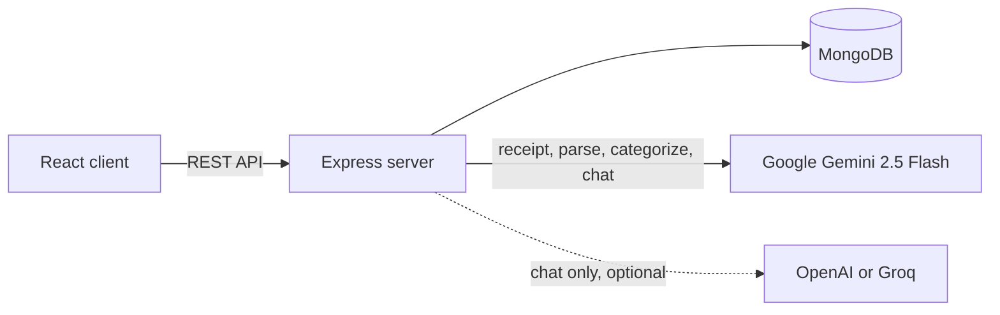

<div align="center">

# 💸 Splitly

**Split smart, settle easy.**

A group expense splitter with AI built in: scan a receipt, type an expense in plain English, or ask a chatbot who owes what.

[](https://ai-split-66al.vercel.app/)


</div>

---

## 🤔 What is Splitly

Splitly helps friends, roommates and travel groups track shared costs. You create a group, add expenses, and Splitly works out each person's balance and the payments needed to settle up. All amounts are shown in Indian Rupees (₹).

On top of that, Splitly uses Google Gemini to save typing: it can read a receipt photo, understand a sentence like *"I paid 600 for pizza for me, Raj and Anu"*, pick a category for you, and answer questions about your group's spending.

## ✨ Features

- 👥 **Groups** – create a group with a name, an emoji and a list of members.
- 🧾 **Add expenses** – record who paid and who shares the cost. The amount is split equally between the people you pick.
- ⚖️ **Balances** – see how much each member is up or down in a group.
- 🤝 **Settle up** – get a short list of "who pays whom" to clear all debts, and mark a payment as settled with one click.
- 📊 **Dashboard** – total amount tracked, number of people and number of groups, plus "you owe" / "you're owed" on each group card.
- 📷 **AI receipt scan** – upload a receipt photo and the form fills in the title, total, category and up to 10 line items.
- 💬 **Plain-English entry** – type what happened and Splitly fills in the title, amount, category, payer and split. Names are matched only to real group members.
- 🏷️ **Auto-categorize** – as you type a title, the category is picked for you (Food, Lodging, Transport, Activities, Shopping or General). It never overrides a category you chose yourself.
- 🤖 **Group chatbot** – ask things like "What's our total?" The bot reads the group's expenses from the database before it answers.
- 🛟 **Offline fallback** – if no AI key is set or the AI call fails, the chatbot still answers simple "total" questions on its own.

## ⚙️ How it works



1. The React app talks to the Express server over a REST API.
2. Accounts, groups and expenses are saved in MongoDB with Mongoose. Passwords are stored as bcrypt hashes.
3. Balances and settle-up payments are calculated on the server from the saved expenses.
4. AI features send a prompt (and, for receipts, the image) to Gemini. The server checks the reply against a fixed list of categories and group members before sending it back.

## 🛠️ Tech stack

| Layer | Technology |
| --- | --- |
| Frontend | React 19 (Create React App), Axios |
| Backend | Node.js, Express 5 |
| Database | MongoDB with Mongoose |
| AI | Google Gemini 2.5 Flash via `@google/genai` (text + vision) |
| Optional chat fallback | OpenAI SDK – `gpt-3.5-turbo`, or Groq `llama-3.3-70b-versatile` when the key starts with `gsk_` |
| Auth | JSON Web Tokens (`jsonwebtoken`), bcrypt password hashing (`bcryptjs`) |
| Hosting config | `vercel.json` in both `client/` and `server/` |

## 🚀 Run locally

**You need:** Node.js and npm, a MongoDB database (local or Atlas), and a Google Gemini API key for the AI features.

### 1. Server

```bash
cd server
npm install
```

Copy `server/.env.example` to `server/.env` and fill in your values:

| Variable | Required | Purpose |
| --- | --- | --- |
| `MONGO_URI` | Recommended | MongoDB connection string. If not set, the server uses a local MongoDB at `127.0.0.1:27017`. |
| `PORT` | Optional | Port the server listens on. Defaults to `5001`, which is what the client expects. |
| `GEMINI_API_KEY` | For AI | Turns on receipt scan, plain-English entry, auto-categorize and the chatbot. |
| `OPENAI_API_KEY` | Optional | Used by the chatbot only when `GEMINI_API_KEY` is not set. A key starting with `gsk_` is sent to Groq instead of OpenAI. |
| `JWT_SECRET` | Recommended | Secret used to sign login tokens. If not set, the server picks a random secret at startup and logs a warning, so tokens stop working after a restart. |

```bash
npm start
```

### 2. Client

Open a new terminal:

```bash
cd client
npm install
npm start
```

The app opens at `http://localhost:3000`. To point it at a different server, copy `client/.env.example` to `client/.env`.

| Variable | Required | Purpose |
| --- | --- | --- |
| `REACT_APP_API_URL` | Optional | Base URL of the server. Defaults to `http://localhost:5001`. |

> **Port note:** the server and client both default to port `5001`. If you change `PORT` in `server/.env`, set `REACT_APP_API_URL` in `client/.env` to match.

## 🔌 API routes

All routes are served under `/api`.

| Method | Path | Purpose |
| --- | --- | --- |
| `POST` | `/api/auth/register` | Create an account (name, email, password). Returns `400` if a field is missing and `409` if the email is taken |
| `POST` | `/api/auth/login` | Log in and get a token |
| `POST` | `/api/groups/create` | Create a group (name, emoji, members) |
| `GET` | `/api/groups/user/:username` | List a user's groups with totals and their net balance |
| `POST` | `/api/expenses/add` | Add an expense and split it equally |
| `GET` | `/api/expenses/:groupId` | List a group's expenses, newest first |
| `GET` | `/api/expenses/settlements/:groupId` | Work out who should pay whom to settle up |
| `GET` | `/api/expenses/user/:username/groups` | List group IDs a user has expenses in |
| `POST` | `/api/ocr/receipt` | Read a base64 receipt image and return title, amount, category and items |
| `POST` | `/api/ai/categorize` | Pick a category for an expense title |
| `POST` | `/api/ai/parse-expense` | Turn a plain-English sentence into expense fields |
| `POST` | `/api/chat` | Ask the chatbot a question about a group's expenses |

## 📁 Project structure

```
Splitly/
├── AI_FEATURES.md          # Deeper notes on the AI features
├── client/                 # React app
│   ├── public/
│   ├── src/
│   │   ├── App.js          # Dashboard, group view, balances, settle up
│   │   ├── components/     # Login, Chatbot, CreateGroupModal, AddExpenseModal
│   │   ├── index.js
│   │   └── index.css
│   ├── package.json
│   └── vercel.json
└── server/                 # Express API
    ├── server.js           # App setup, MongoDB connection, route mounting
    ├── routes/             # auth, groups, expenses, ocr, ai, chat
    ├── models/             # Expense, Group, User, Settlement (Mongoose)
    ├── package.json
    └── vercel.json
```

## 📝 Notes

- Accounts are saved in MongoDB with bcrypt-hashed passwords. Login returns a token, but the other API routes do not check it yet.
- AI answers can be wrong, so the server checks categories and member names against fixed lists before using them.

---

<div align="center">

Made with ☕ and React by [ganesh-tadigadapa](https://github.com/ganesh-tadigadapa)

</div>
